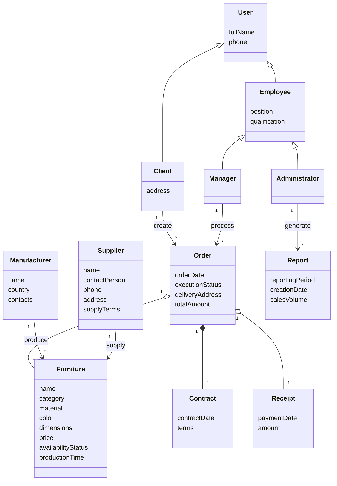

# Контрольне завдання №2: Проектування UML-діаграми концептуальних класів

## Дисципліна: «Організація баз даних та знань»

### Інформація про роботу
- **Тема:** Побудова UML-діаграми концептуальних класів на основі UseCase-діаграми та опису предметної області
- **Предметна область:** База даних меблевого магазину
- **Студент:** Виконано згідно з вимогами робочої програми

---

## Завдання 1. Покрокове проектування концептуальних класів

### Крок 1. Визначення імен класів з іменників у назвах прецедентів UseCase-діаграми
На основі аналізу назв прецедентів з попереднього контрольного завдання (`UseCase.puml`) та акторів виділено такі ключові сутності (іменники):
- `Користувач` (`User`) — базова абстракція для всіх користувачів системи;
- `Клієнт` (`Client`) — покупець меблів;
- `Співробітник` (`Employee`) — персонал магазину;
- `Менеджер з продажу` (`Manager`) — співробітник, відповідальний за роботу з замовленнями;
- `Адміністратор` (`Administrator`) — керівний та технічний персонал;
- `Меблі` / `Товар` (`Furniture`) — із прецедентів «Переглядати каталог меблів», «Отримувати інформацію про наявність та терміни»;
- `Замовлення` (`Order`) — із прецедентів «Оформлювати нове замовлення», «Відстежувати статус замовлення», «Змінювати статус виконання замовлення»;
- `Договір` (`Contract`) — із прецеденту «Формувати договір та квитанцію»;
- `Квитанція` (`Receipt`) — із прецеденту «Формувати договір та квитанцію»;
- `Постачальник` (`Supplier`) — із прецеденту «Вести базу постачальників та виробників»;
- `Виробник` (`Manufacturer`) — із прецеденту «Вести базу постачальників та виробників»;
- `Звіт` (`Report`) — із прецеденту «Формувати аналітичні звіти продажів».

---

### Крок 2. Визначення атрибутів концептуальних класів із опису предметної області
> **Важливо (відповідно до вимог методичних вказівок):**
> Концептуальні класи відображають сутності реального світу і **НЕ містять**:
> 1. Штучних сурогатних атрибутів (ID, унікальних числових ідентифікаторів, первинних ключів);
> 2. Типів даних атрибутів (вони визначаються на етапі логічного проєктування);
> 3. Методів/операцій класів.

- **`User` (Користувач):**
  - `fullName` (ПІБ)
  - `phone` (номер телефону)
- **`Client` (Клієнт):**
  - `address` (адреса проживання / доставки)
- **`Employee` (Співробітник):**
  - `position` (посада)
  - `qualification` (рівень кваліфікації)
- **`Manager` (Менеджер з продажу):**
  - *(специфічні атрибути успадковуються від `Employee`)*
- **`Administrator` (Адміністратор):**
  - *(специфічні атрибути успадковуються від `Employee`)*
- **`Furniture` (Меблі):**
  - `name` (назва виробу / моделі)
  - `category` (категорія меблів: дивани, столи, шафи тощо)
  - `material` (матеріал корпусу та оббивки)
  - `color` (колір / відтінок)
  - `dimensions` (габаритні розміри)
  - `price` (вартість)
  - `availabilityStatus` (статус наявності на складі)
  - `productionTime` (орієнтовний термін виготовлення під замовлення)
- **`Order` (Замовлення):**
  - `orderDate` (дата оформлення)
  - `executionStatus` (поточний статус виконання)
  - `deliveryAddress` (адреса доставки)
  - `totalAmount` (підсумкова вартість замовлення)
- **`Contract` (Договір купівлі-продажу):**
  - `contractDate` (дата укладання)
  - `terms` (умови виготовлення та відповідальності сторін)
- **`Receipt` (Розрахункова квитанція / Чек):**
  - `paymentDate` (дата проведення платежу)
  - `amount` (фактично сплачена сума)
- **`Supplier` (Постачальник фурнітури):**
  - `name` (назва компанії)
  - `contactPerson` (контактна особа)
  - `phone` (телефон)
  - `address` (юридична адреса)
  - `supplyTerms` (умови та графік постачання)
- **`Manufacturer` (Виробник / Фабрика):**
  - `name` (назва фабрики)
  - `country` (країна / регіон розташування)
  - `contacts` (контактні дані)
- **`Report` (Аналітичний звіт):**
  - `reportingPeriod` (звітний період)
  - `creationDate` (дата формування)
  - `salesVolume` (обсяг продажів)

---

### Крок 3 та 4. Визначення зв'язків між класами та їх кратності

1. **Зв'язки узагальнення (спадкування) `--|>`:**
   *(Не містять назв, оскільки мають приховану семантику «успадковувати»)*
   - `Client --|> User` — Клієнт є користувачем системи;
   - `Employee --|> User` — Співробітник є користувачем системи;
   - `Manager --|> Employee` — Менеджер є співробітником;
   - `Administrator --|> Employee` — Адміністратор є співробітником.

2. **Зв'язки агрегації `o--` та композиції `*--`:**
   *(Не містять назв, оскільки мають приховану семантику «містити» або «є частиною»)*
   - `Order "1" o-- "1..*" Furniture` — Замовлення містить від одного до багатьох меблевих виробів;
   - `Order "1" *-- "1" Contract` — Договір є невіддільною композитною частиною замовлення;
   - `Order "1" o-- "1" Receipt` — Замовлення містить розрахункову квитанцію про оплату.

3. **Іменовані асоціації `-->` (у формі дієслів без іменників):**
   *(Напрямок стрілки формує логічне структуроване речення: «Іменник 1» + «дієслово» + «Іменник 2»)*
   - `Client "1" --> "*" Order : create`  
     *(Клієнт [1] створює [*] Замовлення)*
   - `Manager "1" --> "*" Order : process`  
     *(Менеджер [1] опрацьовує [*] Замовлення)*
   - `Administrator "1" --> "*" Report : generate`  
     *(Адміністратор [1] формує [*] Звіт)*
   - `Manufacturer "1" --> "*" Furniture : produce`  
     *(Виробник [1] виготовляє [*] Меблі)*
   - `Supplier "1" --> "*" Furniture : supply`  
     *(Постачальник [1] постачає [*] Меблі / матеріали)*

---

## Завдання 2. UML-діаграма концептуальних класів мовою Mermaid

---

## Завдання 3. Процес створення Pull Request (Code Review)
Після завантаження змін у віддалений репозиторій виконується запит на злиття з такими параметрами:
- **Title (Name):** `DB-CW-2`
- **Reviewers:** `Oleksandr Blazhko`
- **Labels:** `documentation`

*Примітка: Злиття (Merge) гілки до `main`/`master` здійснюється викладачем після перевірки.*
