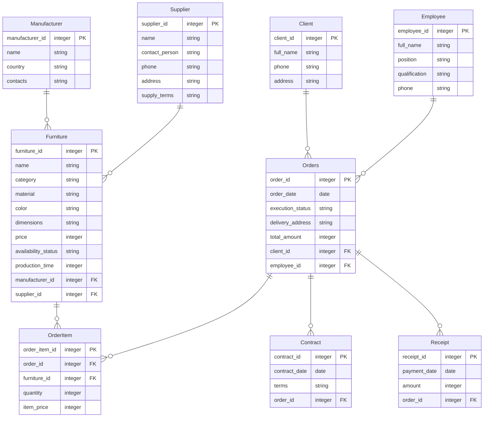

# Логічна схема БД реляційної моделі даних

## Дисципліна: «Організація баз даних та знань»
### Контрольне завдання №3 (Завдання 1 та 2)

**Предметна область:** База даних меблевого магазину  

Логічна схема реляційної моделі даних розроблена на основі UML-діаграми концептуальних класів попереднього етапу проєктування. У схемі визначено сутності (таблиці), атрибути з типами даних, первинні ключі (`PK`), зовнішні ключі (`FK`) та зв'язки між таблицями відповідно до вимог реляційної цілісності.

---

### Опис таблиць та зв'язків:
1. **`Client` (Клієнти):** зберігає інформацію про покупців. Зв'язок один-до-багатьох із `Orders` (`client_id`).
2. **`Employee` (Співробітники):** зберігає дані про персонал магазину (менеджерів, адміністраторів). Зв'язок один-до-багатьох із `Orders` (`employee_id`).
3. **`Manufacturer` (Виробники):** фабрики меблів. Зв'язок один-до-багатьох із `Furniture` (`manufacturer_id`).
4. **`Supplier` (Постачальники):** постачальники матеріалів та фурнітури. Зв'язок один-до-багатьох із `Furniture` (`supplier_id`).
5. **`Furniture` (Меблі / Товари):** каталог виробів із характеристиками, вартістю, статусом наявності та термінами виготовлення.
6. **`Orders` (Замовлення):** замовлення клієнтів із прив'язкою до клієнта та відповідального співробітника.
7. **`OrderItem` (Позиції замовлення):** таблиця зв'язку багато-до-багатьох між замовленнями та меблями, що фіксує кількість та ціну одиниці на момент покупки.
8. **`Contract` (Договори):** юридичні договори купівлі-продажу для замовлень.
9. **`Receipt` (Квитанції):** розрахункові квитанції про оплату замовлень.
