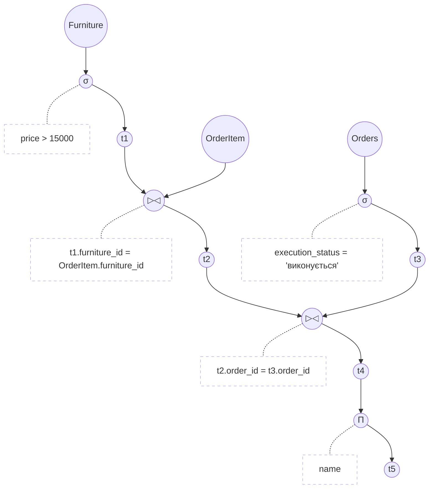

# Дерево реляційної алгебри

## Дисципліна: «Організація баз даних та знань»
### Контрольне завдання №3 (Завдання 3 та 4)

**Предметна область:** База даних меблевого магазину  

---

### Текстовий опис запиту:
> **Запит:** *«Отримати назви меблів (`name`), вартість яких перевищує 15000 грн (`price > 15000`), що були замовлені зі статусом виконання 'виконується' (`execution_status = 'виконується'`)»*.

### Використані операції реляційної алгебри:
1. **З'єднання трьох таблиць:**
   - Таблиця 1: `Furniture` (Меблі);
   - Таблиця 2: `OrderItem` (Позиція замовлення);
   - Таблиця 3: `Orders` (Замовлення).
2. **Вибірка ($\sigma$) для двох таблиць (за стовпцями, що НЕ є PK/FK):**
   - $\sigma_{price > 15000}(Furniture)$ — фільтрація меблів за ціною (не PK/FK стовпець);
   - $\sigma_{execution\_status = 'виконується'}(Orders)$ — фільтрація замовлень за статусом (не PK/FK стовпець).
3. **З'єднання ($\bowtie$, `▷◁`):**
   - Перше з'єднання: $t_1 \bowtie_{t1.furniture\_id = OrderItem.furniture\_id} OrderItem \rightarrow t_2$;
   - Друге з'єднання: $t_2 \bowtie_{t2.order\_id = t3.order\_id} t_3 \rightarrow t_4$.
4. **Проекція ($\Pi$):**
   - $\Pi_{name}(t_4) \rightarrow t_5$ — визначення стовпця назви виробу (`name`) однієї із таблиць (`Furniture`).

---

### Дерево реляційної алгебри мовою Mermaid:

---

### Покрокове пояснення проміжних результатів:
- **`node1 ((Furniture))`**: вихідне відношення меблів.
- **`node2 ((σ))`** з умовою `price > 15000`: вибірка меблів вартістю понад 15 000 грн. Результат записується в проміжне відношення **`node3 ((t1))`**.
- **`node4 ((OrderItem))`**: таблиця зв'язку позицій замовлень.
- **`node5 ((▷◁))`** з умовою `t1.furniture_id = OrderItem.furniture_id`: перше природне/еквіз'єднання відфільтрованих меблів із позиціями замовлень. Результат — проміжне відношення **`node6 ((t2))`**.
- **`node7 ((Orders))`**: вихідне відношення замовлень.
- **`node8 ((σ))`** з умовою `execution_status = 'виконується'`: вибірка замовлень, які наразі перебувають у процесі виконання. Результат — проміжне відношення **`node9 ((t3))`**.
- **`node10 ((▷◁))`** з умовою `t2.order_id = t3.order_id`: друге з'єднання проміжних результатів $t_2$ та $t_3$ за первинним/зовнішнім ключем замовлення. Результат — проміжне відношення **`node11 ((t4))`**.
- **`node12 ((Π))`** з параметром `name`: фінальна операція проекції, що залишає лише атрибут назви меблевого виробу.
- **`node13 ((t5))`**: результуюче відношення.
