# Контрольне завдання №4: Проектування логічної схеми БД ієрархічної моделі даних

## Дисципліна: «Організація баз даних та знань»

### Інформація про роботу
- **Тема:** Побудова логічної схеми БД ієрархічної моделі даних на основі UML-діаграми концептуальних класів через зв'язки між вузлами-класами та вузлами-атрибутами.
- **Предметна область:** База даних меблевого магазину.
- **Студент:** Велієва Л.А., група АІ-253.
- **Термін виконання:** до 8 листопада 2026 року включно.

---

## Зміст каталогу `DB-CW-4`

1. 📄 [`Tree-Model.md`](./Tree-Model.md) — **Завдання 1 та 2:** Логічна схема БД ієрархічної моделі даних, описана мовою розмітки `Mermaid` (`graph TD`), специфікація вузлів-класів і вузлів-атрибутів та обґрунтування правил ієрархічної організації.
2. 📄 [`README.md`](./README.md) — загальний звіт про виконання завдань, опис етапів переходу від концептуальної моделі до ієрархічної та реквізити запиту Pull Request.

---

## Завдання 1 та 2. Проєктування та Mermaid-опис ієрархічної моделі

### 1. Перехід від концептуальної моделі (UML) до ієрархічної моделі даних

На попередньому етапі (`DB-CW-2`) було побудовано UML-діаграму концептуальних класів. При переході до ієрархічної моделі даних враховано ключові принципи організації ієрархічних БД:
- **Деревовидна топологія:** дані організуються у формі орієнтованого кореневого дерева;
- **Корінь дерева (`root`):** кореневим об'єктом обрано `client` (Клієнт), навколо якого будується ланцюг взаємодій у меблевому магазині;
- **Відношення «батько-нащадок» (Parent–Child):**
  - Будь-який `child`-вузол має строго **одного** `parent`-вузла;
  - Кожен `parent`-вузол може мати **довільну кількість** `child`-вузлів (1:N);
- **Розподіл вузлів:**
  - **Вузли-класи:** `client`, `order`, `contract`, `receipt`, `manager`, `furniture`, `manufacturer`, `supplier`;
  - **Вузли-атрибути:** підпорядковані своїм класам як кінцеві властивості (описи вузлів).

---

### 2. Діаграма ієрархічної моделі даних мовою Mermaid

Повний опис схеми розміщено у файлі [`Tree-Model.md`](./Tree-Model.md):

```mermaid
graph TD
    %% Стилізація вузлів
    classDef classNode fill:#D4E6F1,stroke:#2980B9,stroke-width:2px,color:#1B4F72,font-weight:bold;
    classDef attrNode fill:#E8DAEF,stroke:#884EA0,stroke-width:1.5px,color:#512E5F;

    %% 1. Корінь дерева: Клієнт (Client)
    client([client]):::classNode
    
    %% Атрибути Client
    c_fullname([fullName]):::attrNode
    c_phone([phone]):::attrNode
    c_address([address]):::attrNode
    
    client --> c_fullname
    client --> c_phone
    client --> c_address

    %% 2. Дочірній клас: Замовлення (Order)
    order([order]):::classNode
    client --> order

    %% Атрибути Order
    o_date([orderDate]):::attrNode
    o_status([executionStatus]):::attrNode
    o_address([deliveryAddress]):::attrNode
    o_amount([totalAmount]):::attrNode

    order --> o_date
    order --> o_status
    order --> o_address
    order --> o_amount

    %% 3. Дочірній клас: Договір (Contract)
    contract([contract]):::classNode
    order --> contract
    cnt_date([contractDate]):::attrNode
    cnt_terms([terms]):::attrNode
    contract --> cnt_date
    contract --> cnt_terms

    %% 4. Дочірній клас: Квитанція (Receipt)
    receipt([receipt]):::classNode
    order --> receipt
    rcp_date([paymentDate]):::attrNode
    rcp_amount([amount]):::attrNode
    receipt --> rcp_date
    receipt --> rcp_amount

    %% 5. Дочірній клас: Менеджер (Manager)
    manager([manager]):::classNode
    order --> manager
    m_fullname([fullName]):::attrNode
    m_phone([phone]):::attrNode
    m_position([position]):::attrNode
    m_qual([qualification]):::attrNode
    manager --> m_fullname
    manager --> m_phone
    manager --> m_position
    manager --> m_qual

    %% 6. Дочірній клас: Меблі (Furniture)
    furniture([furniture]):::classNode
    order --> furniture

    %% Атрибути Furniture
    f_name([name]):::attrNode
    f_category([category]):::attrNode
    f_material([material]):::attrNode
    f_color([color]):::attrNode
    f_dim([dimensions]):::attrNode
    f_price([price]):::attrNode
    f_avail([availabilityStatus]):::attrNode
    f_prodtime([productionTime]):::attrNode

    furniture --> f_name
    furniture --> f_category
    furniture --> f_material
    furniture --> f_color
    furniture --> f_dim
    furniture --> f_price
    furniture --> f_avail
    furniture --> f_prodtime

    %% 7. Дочірній клас: Виробник (Manufacturer)
    manufacturer([manufacturer]):::classNode
    furniture --> manufacturer
    mfr_name([name]):::attrNode
    mfr_country([country]):::attrNode
    mfr_contacts([contacts]):::attrNode
    manufacturer --> mfr_name
    manufacturer --> mfr_country
    manufacturer --> mfr_contacts

    %% 8. Дочірній клас: Постачальник (Supplier)
    supplier([supplier]):::classNode
    furniture --> supplier
    sup_name([name]):::attrNode
    sup_contact([contactPerson]):::attrNode
    sup_phone([phone]):::attrNode
    sup_address([address]):::attrNode
    sup_terms([supplyTerms]):::attrNode
    supplier --> sup_name
    supplier --> sup_contact
    supplier --> sup_phone
    supplier --> sup_address
    supplier --> sup_terms
```

---

## Завдання 3. Процес створення Pull Request (Code Review)

Для проходження процедури рецензування (Code Review) виконано запит на злиття змін до основної гілки репозиторію з такими встановленими параметрами:
- **Title (Name):** `DB-CW-4`
- **Reviewers:** `Oleksandr Blazhko` (`oleksandrblazhko`)
- **Labels:** `documentation`

> **Важлива примітка:** Злиття гілки (`Merge pull request`) самостійно не виконується — відповідно до правил регламенту це здійснює викладач після перевірки та погодження змін.
