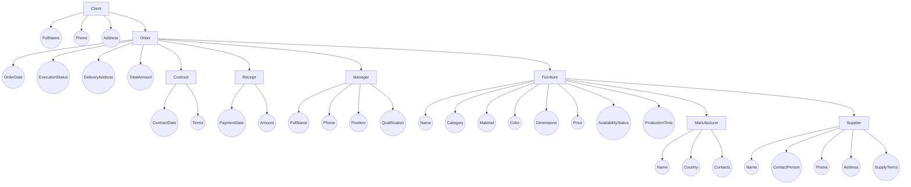

# Логічна схема БД ієрархічної моделі даних

## Дисципліна: «Організація баз даних та знань»
### Контрольне завдання №4 (Завдання 1 та 2)

**Предметна область:** База даних меблевого магазину  
**Виконала:** студентка групи АІ-253 Велієва Л.А.  

---

## 1. Теоретичні засади та правила проєктування

Відповідно до методичних вказівок та вимог до контрольного завдання №4, ієрархічна модель даних представляється у вигляді орієнтованого графа — дерева (tree), для якого виконуються такі базові правила:
1. **Кожен об'єкт предметної області представлений як вузол (node) дерева**:
   - **Вузли-класи (Class Nodes / Segments)** — позначають сутності концептуальної моделі та відображаються прямокутниками `[ClassName]`;
   - **Вузли-атрибути (Attribute Nodes)** — позначають властивості відповідних сутностей та відображаються колами `((AttributeName))`.
2. **Єдиний корінь дерева (Root Node)**: існує рівно один кореневий об'єкт на найвищому рівні ієрархії. У розробленій моделі коренем обрано сутність `CLIENT[Client]` (Клієнт), оскільки обслуговування клієнта є центральним процесом функціонування меблевого магазину.
3. **Відношення «батько-нащадок» (Parent–Child Relationship, PCR)**:
   - Вузли пов'язані спрямованими зв'язками зверху вниз від parent-вузла до child-вузла;
   - **Один parent-вузол може мати багато зв'язків із child-вузлами** (відношення 1:N);
   - **Один child-вузол має зв'язок лише з одним parent-вузлом** (строга деревоподібна цілісність без циклів та множинного батьківства).
4. **Збереження властивостей**: властивості класів зберігаються як вузли-атрибути, підпорядковані своєму вузлу-класу (child-вузли властивостей).

---

## 2. Логічна схема БД ієрархічної моделі даних мовою Mermaid

Нижче наведено логічну схему ієрархічної моделі даних, оформлену відповідно до зразка опису (класи представлені прямокутниками `ID[Name]`, атрибути — колами `id((Name))`):

---

## 3. Специфікація вузлів ієрархічної моделі

### 3.1. Вузли-класи (Class Nodes / Сегменти)

| Рівень ієрархії | Вузол-клас | Батьківський вузол (Parent) | Опис сутності в межах моделі |
|:---:|:---|:---|:---|
| **0 (Root)** | `CLIENT[Client]` | *Відсутній (Корінь дерева)* | Клієнт магазину, що ініціює замовлення меблевих виробів |
| **1** | `ORDER[Order]` | `CLIENT[Client]` | Замовлення, оформлене клієнтом |
| **2** | `CONTRACT[Contract]` | `ORDER[Order]` | Договір купівлі-продажу / виготовлення під замовлення |
| **2** | `RECEIPT[Receipt]` | `ORDER[Order]` | Фінансовий платіжний документ (квитанція про сплату) |
| **2** | `MANAGER[Manager]` | `ORDER[Order]` | Менеджер магазину, відповідальний за супровід замовлення |
| **2** | `FURNITURE[Furniture]` | `ORDER[Order]` | Одиниця меблевого виробу, включена до замовлення |
| **3** | `MANUFACTURER[Manufacturer]` | `FURNITURE[Furniture]` | Фабрика-виробник замовленого меблевого виробу |
| **3** | `SUPPLIER[Supplier]` | `FURNITURE[Furniture]` | Постачальник комплектуючих та фурнітури для виробу |

### 3.2. Вузли-атрибути (Attribute Nodes) за класами

1. **`CLIENT[Client]`**:
   - `FullName` — повне ім'я (ПІБ) клієнта;
   - `Phone` — контактний номер телефону;
   - `Address` — адреса проживання / доставки.
2. **`ORDER[Order]`**:
   - `OrderDate` — дата реєстрації замовлення;
   - `ExecutionStatus` — поточний стан виконання (нове, комплектується, виготовляється, готове, доставлено);
   - `DeliveryAddress` — точна адреса доставки;
   - `TotalAmount` — загальна розрахункова вартість замовлення.
3. **`CONTRACT[Contract]`**:
   - `ContractDate` — дата підписання договору;
   - `Terms` — юридичні умови виконання, гарантійні зобов'язання та терміни.
4. **`RECEIPT[Receipt]`**:
   - `PaymentDate` — дата внесення оплати клієнтом;
   - `Amount` — фактично внесена сума коштів.
5. **`MANAGER[Manager]`**:
   - `FullName` — ПІБ менеджера з продажу;
   - `Phone` — робочий контактний телефон;
   - `Position` — посада співробітника;
   - `Qualification` — рівень кваліфікації / грейд.
6. **`FURNITURE[Furniture]`**:
   - `Name` — торгова назва меблевого виробу;
   - `Category` — категорія меблів (дивани, ліжка, столи, шафи тощо);
   - `Material` — основний матеріал корпусу / оббивки;
   - `Color` — колір та кодування відтінку;
   - `Dimensions` — габаритні розміри (ширина × висота × глибина);
   - `Price` — базова ціна виробу;
   - `AvailabilityStatus` — статус наявності товару на складі;
   - `ProductionTime` — час виготовлення фабрикою при замовленні.
7. **`MANUFACTURER[Manufacturer]`**:
   - `Name` — найменування меблевої фабрики;
   - `Country` — країна та місто розташування виробничих потужностей;
   - `Contacts` — корпоративні контактні дані виробника.
8. **`SUPPLIER[Supplier]`**:
   - `Name` — комерційна назва компанії-постачальника фурнітури;
   - `ContactPerson` — контактна особа представника постачальника;
   - `Phone` — номер телефону відділу збуту постачальника;
   - `Address` — адреса регіонального складу / офісу;
   - `SupplyTerms` — умови, графік та мінімальний обсяг постачання.

---

## 4. Висновки щодо відповідності вимогам

- Схема містить **строго один корінь** (`CLIENT[Client]`);
- Усі міжкласові відношення мають вигляд **1:N (parent–child)**;
- Будь-який child-вузол зв'язаний **лише з одним parent-вузлом**;
- Властивості об'єктів явно представлені як підпорядковані **вузли-атрибути** (кола `((...))`);
- Вузли-класи оформлені прямокутниками `[...]` відповідно до еталонного прикладу;
- Схема повністю сумісна з синтаксисом **GitHub Markdown Mermaid** та коректно візуалізується.
