# Логічна схема БД ієрархічної моделі даних

## Дисципліна: «Організація баз даних та знань»
### Контрольне завдання №4 (Завдання 1 та 2)

**Предметна область:** База даних меблевого магазину  
**Виконала:** студентка групи АІ-253 Велієва Л.А.  

---

## 1. Теоретичні засади та правила проєктування

Відповідно до методичних вказівок та вимог до контрольного завдання №4, ієрархічна модель даних представляється у вигляді орієнтованого графа — дерева (tree), для якого виконуються такі базові правила:
1. **Кожен об'єкт предметної області представлений як вузол (node) дерева**:
   - **Вузли-класи (Class Nodes / Segments)** — позначають сутності концептуальної моделі;
   - **Вузли-атрибути (Attribute Nodes)** — позначають властивості відповідних сутностей.
2. **Єдиний корінь дерева (Root Node)**: існує рівно один кореневий об'єкт на найвищому рівні ієрархії. У розробленій моделі коренем обрано сутність `client` (Клієнт), оскільки обслуговування клієнта є центральним процесом функціонування меблевого магазину.
3. **Відношення «батько-нащадок» (Parent–Child Relationship, PCR)**:
   - Вузли пов'язані спрямованими зв'язками зверху вниз від parent-вузла до child-вузла;
   - **Один parent-вузол може мати багато зв'язків із child-вузлами** (відношення 1:N);
   - **Один child-вузол має зв'язок лише з одним parent-вузлом** (строга деревоподібна цілісність без циклів та множинного батьківства).
4. **Збереження властивостей**: властивості класів зберігаються як вузли-атрибути, підпорядковані своєму вузлу-класу (child-вузли властивостей).

---

## 2. Логічна схема БД ієрархічної моделі даних мовою Mermaid

Нижче наведено логічну схему ієрархічної моделі даних, спроєктовану на основі концептуальної UML-діаграми класів із контрольного завдання №2 (`DB-CW-2`).

```mermaid
graph TD
    %% Стилізація вузлів: класи (синій акцент) та атрибути (фіолетовий акцент)
    classDef classNode fill:#D4E6F1,stroke:#2980B9,stroke-width:2px,color:#1B4F72,font-weight:bold;
    classDef attrNode fill:#E8DAEF,stroke:#884EA0,stroke-width:1.5px,color:#512E5F;

    %% 1. Корінь дерева: Клієнт (Client)
    client([client]):::classNode
    
    %% Атрибути Client
    c_fullname([fullName]):::attrNode
    c_phone([phone]):::attrNode
    c_address([address]):::attrNode
    
    client --> c_fullname
    client --> c_phone
    client --> c_address

    %% 2. Дочірній клас: Замовлення (Order)
    order([order]):::classNode
    client --> order

    %% Атрибути Order
    o_date([orderDate]):::attrNode
    o_status([executionStatus]):::attrNode
    o_address([deliveryAddress]):::attrNode
    o_amount([totalAmount]):::attrNode

    order --> o_date
    order --> o_status
    order --> o_address
    order --> o_amount

    %% 3. Дочірній клас: Договір (Contract)
    contract([contract]):::classNode
    order --> contract
    cnt_date([contractDate]):::attrNode
    cnt_terms([terms]):::attrNode
    contract --> cnt_date
    contract --> cnt_terms

    %% 4. Дочірній клас: Квитанція (Receipt)
    receipt([receipt]):::classNode
    order --> receipt
    rcp_date([paymentDate]):::attrNode
    rcp_amount([amount]):::attrNode
    receipt --> rcp_date
    receipt --> rcp_amount

    %% 5. Дочірній клас: Менеджер (Manager)
    manager([manager]):::classNode
    order --> manager
    m_fullname([fullName]):::attrNode
    m_phone([phone]):::attrNode
    m_position([position]):::attrNode
    m_qual([qualification]):::attrNode
    manager --> m_fullname
    manager --> m_phone
    manager --> m_position
    manager --> m_qual

    %% 6. Дочірній клас: Меблі (Furniture)
    furniture([furniture]):::classNode
    order --> furniture

    %% Атрибути Furniture
    f_name([name]):::attrNode
    f_category([category]):::attrNode
    f_material([material]):::attrNode
    f_color([color]):::attrNode
    f_dim([dimensions]):::attrNode
    f_price([price]):::attrNode
    f_avail([availabilityStatus]):::attrNode
    f_prodtime([productionTime]):::attrNode

    furniture --> f_name
    furniture --> f_category
    furniture --> f_material
    furniture --> f_color
    furniture --> f_dim
    furniture --> f_price
    furniture --> f_avail
    furniture --> f_prodtime

    %% 7. Дочірній клас: Виробник (Manufacturer)
    manufacturer([manufacturer]):::classNode
    furniture --> manufacturer
    mfr_name([name]):::attrNode
    mfr_country([country]):::attrNode
    mfr_contacts([contacts]):::attrNode
    manufacturer --> mfr_name
    manufacturer --> mfr_country
    manufacturer --> mfr_contacts

    %% 8. Дочірній клас: Постачальник (Supplier)
    supplier([supplier]):::classNode
    furniture --> supplier
    sup_name([name]):::attrNode
    sup_contact([contactPerson]):::attrNode
    sup_phone([phone]):::attrNode
    sup_address([address]):::attrNode
    sup_terms([supplyTerms]):::attrNode
    supplier --> sup_name
    supplier --> sup_contact
    supplier --> sup_phone
    supplier --> sup_address
    supplier --> sup_terms
```

---

## 3. Специфікація вузлів ієрархічної моделі

### 3.1. Вузли-класи (Class Nodes / Сегменти)

| Рівень ієрархії | Вузол-клас | Батьківський вузол (Parent) | Опис сутності в межах моделі |
|:---:|:---|:---|:---|
| **0 (Root)** | `client` | *Відсутній (Корінь дерева)* | Клієнт магазину, що ініціює замовлення меблевих виробів |
| **1** | `order` | `client` | Замовлення, оформлене клієнтом |
| **2** | `contract` | `order` | Договір купівлі-продажу / виготовлення під замовлення |
| **2** | `receipt` | `order` | Фінансовий платіжний документ (квитанція про сплату) |
| **2** | `manager` | `order` | Менеджер магазину, відповідальний за супровід замовлення |
| **2** | `furniture` | `order` | Одиниця меблевого виробу, включена до замовлення |
| **3** | `manufacturer`| `furniture` | Фабрика-виробник замовленого меблевого виробу |
| **3** | `supplier` | `furniture` | Постачальник комплектуючих та фурнітури для виробу |

### 3.2. Вузли-атрибути (Attribute Nodes) за класами

1. **`client`**:
   - `fullName` — повне ім'я (ПІБ) клієнта;
   - `phone` — контактний номер телефону;
   - `address` — адреса проживання / доставки.
2. **`order`**:
   - `orderDate` — дата реєстрації замовлення;
   - `executionStatus` — поточний стан виконання (нове, комплектується, виготовляється, готове, доставлено);
   - `deliveryAddress` — точна адреса доставки;
   - `totalAmount` — загальна розрахункова вартість замовлення.
3. **`contract`**:
   - `contractDate` — дата підписання договору;
   - `terms` — юридичні умови виконання, гарантійні зобов'язання та терміни.
4. **`receipt`**:
   - `paymentDate` — дата внесення оплати клієнтом;
   - `amount` — фактично внесена сума коштів.
5. **`manager`**:
   - `fullName` — ПІБ менеджера з продажу;
   - `phone` — робочий контактний телефон;
   - `position` — посада співробітника;
   - `qualification` — рівень кваліфікації / грейд.
6. **`furniture`**:
   - `name` — торгова назва меблевого виробу;
   - `category` — категорія меблів (дивани, ліжка, столи, шафи тощо);
   - `material` — основний матеріал корпусу / оббивки;
   - `color` — колір та кодування відтінку;
   - `dimensions` — габаритні розміри (ширина × висота × глибина);
   - `price` — базова ціна виробу;
   - `availabilityStatus` — статус наявності товару на складі;
   - `productionTime` — час виготовлення фабрикою при замовленні.
7. **`manufacturer`**:
   - `name` — найменування меблевої фабрики;
   - `country` — країна та місто розташування виробничих потужностей;
   - `contacts` — корпоративні контактні дані виробника.
8. **`supplier`**:
   - `name` — комерційна назва компанії-постачальника фурнітури;
   - `contactPerson` — контактна особа представника постачальника;
   - `phone` — номер телефону відділу збуту постачальника;
   - `address` — адреса регіонального складу / офісу;
   - `supplyTerms` — умови, графік та мінімальний обсяг постачання.

---

## 4. Висновки щодо відповідності вимогам

- Схема містить **строго один корінь** (`client`);
- Усі міжкласові відношення мають вигляд **1:N (parent–child)**;
- Будь-який child-вузол зв'язаний **лише з одним parent-вузлом**;
- Властивості об'єктів явно представлені як підпорядковані **вузли-атрибути**;
- Схема повністю сумісна з синтаксисом **GitHub Markdown Mermaid** та коректно візуалізується.
