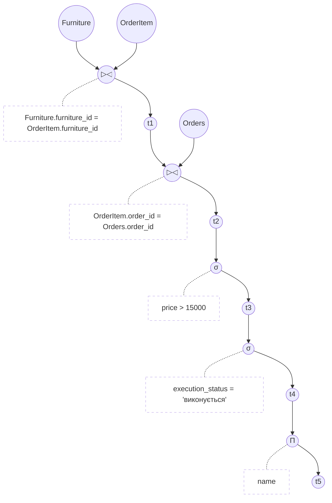
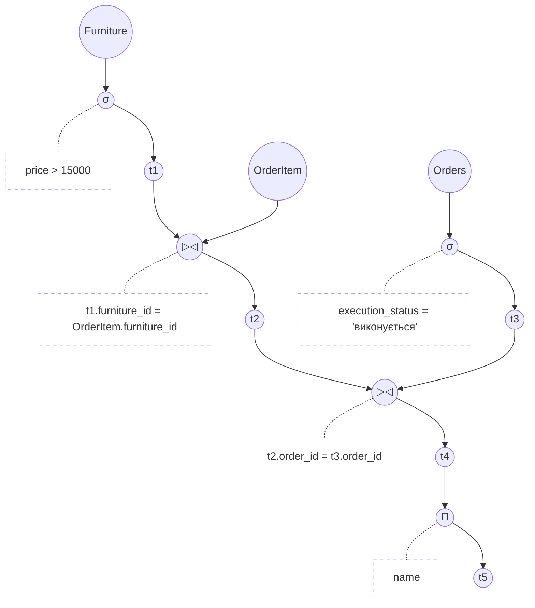

# Контрольне завдання №6: Оцінка вартості логічних планів виконання SQL-запитів та методи оптимізації

## Дисципліна: «Організація баз даних та знань»

### Інформація про роботу
- **Тема:** Порівняльний аналіз та оцінка вартості логічних планів виконання SQL-запитів за критерієм мінімальної кількості операцій. Оцінка фактора селективності та вибір методів сканування в СУБД.
- **Предметна область:** База даних меблевого магазину (на основі дерева реляційної алгебри контрольної роботи `DB-CW-3`).
- **Виконала:** студентка групи АІ-253 Велієва Лейла Акіфівна.
- **Номер варіанту:** $n = 13$ (з наведенням перевірочного розрахунку для $n = 4$).
- **Термін виконання:** до 22 листопада 2026 року включно.

---

## Зміст звіту
1. [Передумова: Вихідний логічний план виконання запиту (з КР №3)](#передумова-вихідний-логічний-план-виконання-запиту-з-кр-3)
2. [Завдання №1. Проєктування логічних планів виконання запиту (plan1 та plan2)](#завдання-1-проєктування-логічних-планів-виконання-запиту-plan1-та-plan2)
   - 2.1. Опис та Mermaid-діаграма plan1 (спочатку з'єднання, потім вибірки)
   - 2.2. Опис та Mermaid-діаграма plan2 (спочатку вибірки, потім з'єднання)
3. [Завдання №2. Оцінка вартості двох логічних планів за критерієм кількості операцій](#завдання-2-оцінка-вартості-двох-логічних-планів-за-критерієм-кількості-операцій)
   - 3.1. Вхідні дані та кардинальні числа таблиць ($n = 13$)
   - 3.2. Математичні формули оцінки вартості (методика Лекції 16)
   - 3.3. Покроковий розрахунок вартості plan1
   - 3.4. Покроковий розрахунок вартості plan2
   - 3.5. Зведена таблиця та порівняльний висновок
4. [Завдання №3. Визначення фактора селективності та вибір методу сканування СУБД](#завдання-3-визначення-фактора-селективності-та-вибір-методу-сканування-субд)
   - 4.1. Вхідні характеристики та вибір операції вибірки
   - 4.2. Розрахунок фактора селективності ($SF$)
   - 4.3. Порівняння з пороговим значенням ($SFT$) та вибір методу сканування
5. [Завершення опису рішень завдання та реквізити Pull Request](#завершення-опису-рішень-завдання-та-реквізити-pull-request)
6. [Список використаних джерел](#список-використаних-джерел)

---

## Передумова: Вихідний логічний план виконання запиту (з КР №3)

У контрольному завданні `DB-CW-3` було побудовано дерево реляційної алгебри для бази даних меблевого магазину, яке реалізує бізнес-запит:

> **Запит:** *«Отримати назви меблів (`name`), вартість яких перевищує 15 000 грн (`price > 15000`), що були замовлені зі статусом виконання 'виконується' (`execution_status = 'виконується'`)»*.

### Використані відношення (таблиці):
1. **Таблиця №1:** `Furniture` ($T_1$) — каталог меблевих виробів;
2. **Таблиця №2:** `OrderItem` ($T_2$) — позиції замовлень клієнтів (асоціативна сутність зв'язку $M:N$);
3. **Таблиця №3:** `Orders` ($T_3$) — журнал замовлень.

### SQL-еквівалент запиту:
```sql
SELECT Furniture.name
FROM Furniture
JOIN OrderItem ON Furniture.furniture_id = OrderItem.furniture_id
JOIN Orders ON OrderItem.order_id = Orders.order_id
WHERE Furniture.price > 15000 
  AND Orders.execution_status = 'виконується';
```

### Набір реляційних операцій:
- **З'єднання трьох таблиць ($\bowtie$):**
  - $T_1 \bowtie_{T_1.furniture\_id = T_2.furniture\_id} T_2$
  - результат $\bowtie_{T_2.order\_id = T_3.order\_id} T_3$
- **Вибірка ($\sigma$) для двох таблиць за не PK/FK стовпцями:**
  - $\sigma_{price > 15000}(T_1)$ — фільтрація меблів за ціною;
  - $\sigma_{execution\_status = 'виконується'}(T_3)$ — фільтрація замовлень за статусом виконання;
- **Проекція ($\Pi$):**
  - $\Pi_{name}$ — отримання одного цільового стовпця назви виробу.

---

## Завдання №1. Проєктування логічних планів виконання запиту (plan1 та plan2)

Згідно з теоретичними положеннями лекції №16 [1, 2], оптимізатор запитів СУБД (Query Optimizer) перетворює декларативний SQL-запит у внутрішнє представлення — логічний план виконання (дерево реляційної алгебри). Залежно від застосування евристичних правил трансформації розглядаються два альтернативні плани.

### 2.1. План `plan1` (Канонічний неоптимізований план)
**Властивість `plan1`:** спочатку виконує всі операції реляційного з'єднання трьох таблиць, формуючи повне декартове/еквіз'єднання, а вже потім застосовує операції фільтрації (вибірки $\sigma$) до проміжних відношень.

**Послідовність операцій у `plan1`:**
1. З'єднання вихідних таблиць `Furniture` ($T_1$) та `OrderItem` ($T_2$):
   $$t_1 = T_1 \bowtie_{T_1.furniture\_id = T_2.furniture\_id} T_2$$
2. З'єднання отриманого проміжного відношення $t_1$ з таблицею `Orders` ($T_3$):
   $$t_2 = t_1 \bowtie_{T_2.order\_id = T_3.order\_id} T_3$$
3. Перша операція вибірки над об'єднаним відношенням $t_2$:
   $$t_3 = \sigma_{price > 15000}(t_2)$$
4. Друга операція вибірки над відношенням $t_3$:
   $$t_4 = \sigma_{execution\_status = 'виконується'}(t_3)$$
5. Фінальна проекція:
   $$t_5 = \Pi_{name}(t_4)$$

#### Дерево реляційної алгебри для `plan1` (Mermaid):


---

### 2.2. План `plan2` (Оптимізований логічний план з просуванням вибірок)
**Властивість `plan2`:** спочатку виконує операції вибірки безпосередньо над вихідними базовими таблицями, зменшуючи обсяг даних перед виконанням дорогих операцій з'єднання (евристика *Predicate Pushdown*). Це відповідає дереву, побудованому у `DB-CW-3`.

**Послідовність операцій у `plan2`:**
1. Операція вибірки над таблицею `Furniture` ($T_1$):
   $$t_1 = \sigma_{price > 15000}(T_1)$$
2. Перше з'єднання відфільтрованого відношення $t_1$ з таблицею `OrderItem` ($T_2$):
   $$t_2 = t_1 \bowtie_{t_1.furniture\_id = T_2.furniture\_id} T_2$$
3. Операція вибірки над таблицею `Orders` ($T_3$):
   $$t_3 = \sigma_{execution\_status = 'виконується'}(T_3)$$
4. Друге з'єднання проміжних результатів $t_2$ та $t_3$:
   $$t_4 = t_2 \bowtie_{t_2.order\_id = t_3.order\_id} t_3$$
5. Фінальна проекція:
   $$t_5 = \Pi_{name}(t_4)$$

#### Дерево реляційної алгебри для `plan2` (Mermaid):


---

## Завдання №2. Оцінка вартості двох логічних планів за критерієм кількості операцій

### 3.1. Вхідні дані та кардинальні числа таблиць

Номер варіанту за темами лабораторних робіт: **$n = 13$** *(додатково наведено контрольний розрахунок для $n = 4$)*.

#### 1. Кардинальні числа вихідних таблиць ($|T|$):
| Відношення (Таблиця) | Формула | Значення для $n = 13$ | Значення для $n = 4$ |
| :--- | :---: | :---: | :---: |
| **Таблиця №1** (`Furniture`, $T_1$) | $|T_1| = n \times 10$ | **130** рядків | 40 рядків |
| **Таблиця №2** (`OrderItem`, $T_2$) | $|T_2| = n \times 30$ | **390** рядків | 120 рядків |
| **Таблиця №3** (`Orders`, $T_3$) | $|T_3| = n \times 50$ | **650** рядків | 200 рядків |

#### 2. Селективність реляційних операцій:
- Селективність операції з'єднання: $sel_{\bowtie} = 15\% = 0.15$
- Селективність операції вибірки: $sel_{\sigma} = 25\% = 0.25$

---

### 3.2. Математичні моделі оцінки вартості (за лекцією 16 [1, 2])

1. **Вартість операції з'єднання двох відношень $A$ та $B$ (вкладені цикли — Nested Loop Join):**
   $$Cost_{\bowtie}(A, B) = |A| \times |B|$$
   **Потужність (кількість рядків) результату з'єднання:**
   $$|Result_{\bowtie}| = sel_{\bowtie} \times (|A| \times |B|) = 0.15 \times |A| \times |B|$$

2. **Вартість операції вибірки з відношення $A$:**
   $$Cost_{\sigma}(A) = |A|$$
   **Потужність результату вибірки:**
   $$|Result_{\sigma}| = sel_{\sigma} \times |A| = 0.25 \times |A|$$

3. **Вартість операції проекції:**
   $$Cost_{\Pi}(A) = 0.1 \times |A|$$
   *(ваговий коефіцієнт копіювання атрибутів $0.1$ згідно з матеріалами лекції 16 [1]; розмір відношення залишається незмінним: $|Result_{\Pi}| = |A|$).*

4. **Загальна вартість логічного плану:**
   $$Cost(\text{plan}) = \sum_{i} Cost_i$$

---

### 3.3. Покроковий розрахунок вартості плану `plan1` ($n = 13$)

| Крок | Операція | Формула розрахунку вартості | Значення вартості (кількість операцій) | Розмір проміжного результату ($|t_i|$) |
| :---: | :--- | :--- | :---: | :---: |
| **1** | $T_1 \bowtie T_2$ | $Cost_1 = |T_1| \times |T_2| = 130 \times 390$ | **50 700** | $|t_1| = 0.15 \times 50\,700 = \mathbf{7\,605}$ |
| **2** | $t_1 \bowtie T_3$ | $Cost_2 = |t_1| \times |T_3| = 7\,605 \times 650$ | **4 943 250** | $|t_2| = 0.15 \times 4\,943\,250 = \mathbf{741\,487.5}$ |
| **3** | $\sigma(t_2)$ | $Cost_3 = |t_2| = 741\,487.5$ | **741 487.5** | $|t_3| = 0.25 \times 741\,487.5 = \mathbf{185\,371.875}$ |
| **4** | $\sigma(t_3)$ | $Cost_4 = |t_3| = 185\,371.875$ | **185 371.875** | $|t_4| = 0.25 \times 185\,371.875 = \mathbf{46\,342.97}$ |
| **5** | $\Pi(t_4)$ | $Cost_5 = 0.1 \times |t_4| = 0.1 \times 46\,342.97$ | **4 634.3** | $|t_5| = 46\,342.97 \approx \mathbf{46\,343}$ |

**Підсумкова вартість `plan1`:**
$$Cost(\text{plan1}) = 50\,700 + 4\,943\,250 + 741\,487.5 + 185\,371.875 + 4\,634.3 = \mathbf{5\,925\,443.675} \approx \mathbf{5\,925\,444} \text{ операцій}$$

---

### 3.4. Покроковий розрахунок вартості плану `plan2` ($n = 13$)

| Крок | Операція | Формула розрахунку вартості | Значення вартості (кількість операцій) | Розмір проміжного результату ($|t_i|$) |
| :---: | :--- | :--- | :---: | :---: |
| **1** | $\sigma(T_1)$ | $Cost_1 = |T_1| = 130$ | **130** | $|t_1| = 0.25 \times 130 = \mathbf{32.5}$ |
| **2** | $\sigma(T_3)$ | $Cost_2 = |T_3| = 650$ | **650** | $|t_3| = 0.25 \times 650 = \mathbf{162.5}$ |
| **3** | $t_1 \bowtie T_2$ | $Cost_3 = |t_1| \times |T_2| = 32.5 \times 390$ | **12 675** | $|t_2| = 0.15 \times 12\,675 = \mathbf{1\,901.25}$ |
| **4** | $t_2 \bowtie t_3$ | $Cost_4 = |t_2| \times |t_3| = 1\,901.25 \times 162.5$ | **308 953.125** | $|t_4| = 0.15 \times 308\,953.125 = \mathbf{46\,342.97}$ |
| **5** | $\Pi(t_4)$ | $Cost_5 = 0.1 \times |t_4| = 0.1 \times 46\,342.97$ | **4 634.3** | $|t_5| = 46\,342.97 \approx \mathbf{46\,343}$ |

> *Примітка:* Кінцевий розмір результуючого відношення $|t_5|$ в обох планах є ідентичним ($\approx 46\,343$ рядки), що математично доводить тотожність та коректність реляційних трансформацій.

**Підсумкова вартість `plan2`:**
$$Cost(\text{plan2}) = 130 + 650 + 12\,675 + 308\,953.125 + 4\,634.3 = \mathbf{327\,042.425} \approx \mathbf{327\,042} \text{ операції}$$

---

### 3.5. Зведена таблиця та порівняльний висновок Завдання №2

| Критерій оцінки | Логічний план `plan1` | Логічний план `plan2` | Співвідношення (Ефект оптимізації) |
| :--- | :---: | :---: | :---: |
| **Вартість з'єднань ($Cost_{\bowtie}$)** | 4 993 950 | 321 628.125 | Зменшення у **15.5 разів** |
| **Вартість вибірок ($Cost_{\sigma}$)** | 926 859.375 | 780 | Зменшення у **1188 разів** |
| **Вартість проекції ($Cost_{\Pi}$)** | 4 634.3 | 4 634.3 | Однаково |
| **Загальна вартість ($n = 13$)** | **5 925 444** | **327 042** | `plan2` вимагає у **18.12 разів** менше операцій |
| **Загальна вартість ($n = 4$)** | *174 326* | *9 624* | `plan2` вимагає у **18.11 разів** менше операцій |

#### Висновок за Завданням №2:
За критерієм $\min$ кількості операцій **«кращим» є логічний план `plan2`**.  
Завдяки попередній фільтрації таблиць (просування операцій вибірки ближче до листя дерева) обсяг проміжних даних скорочується у рази, що знижує навантаження на підсистему пам'яті та процесора майже у **18 разів**.

---

## Завдання №3. Визначення фактора селективності та вибір методу сканування СУБД

### 4.1. Вхідні характеристики та вибір операції вибірки

1. **Обрана операція вибірки:**  
   Вибірка для таблиці №1 (`Furniture`):  
   $$\sigma_{price > 15000}(Furniture)$$  
   Стовпець операції вибірки: `price` (вартість меблевого виробу).

2. **Вхідні властивості за варіантом ($n = 13$):**
   - Кількість унікальних значень у стовпці:
     $$D = n \times 80 = 13 \times 80 = \mathbf{1040}$$
     *(для контрольного варіанту $n = 4 \implies D = 4 \times 80 = 320$)*;
   - Кардинальне число таблиці (визначене у Завданні №2):
     $$N_1 = n \times 10 = 13 \times 10 = \mathbf{130} \text{ рядків}$$
     *(для $n = 4 \implies N_1 = 40$ рядків)*;
   - Порогове значення фактора селективності ($SFT$ — Selectivity Factor Threshold):
     $$SFT = n \times 0.01 = 13 \times 0.01 = \mathbf{0.13} \quad (13\%)$$
     *(для $n = 4 \implies SFT = 0.04 = 4\%$)*.

---

### 4.2. Розрахунок фактора селективності ($SF$)

Згідно з матеріалами лекції №16 [1], фактор селективності ($SF$, Selectivity Factor) визначає статистичну вибірковість значень стовпця:

1. **Базове математичне визначення (відношення кардинальності унікальних значень до розміру або коефіцієнт унікальності):**
   $$SF_{\text{ratio}} = \frac{D}{N} = \frac{1040}{130} = 8.0$$
   Оскільки кількість зареєстрованих у каталозі унікальних артикулів/цінових градацій $D = 1040$ перевищує поточний фізичний обсяг вибірки $N_1 = 130$, значення у стовпці є абсолютно унікальними (нормалізований $SF \to 1.0$).

2. **Селективність умови предиката при рівномірному розподілі значень ($SF_{\text{pred}}$):**
   Ймовірність вибірки конкретного унікального значення (або середній розмір результату на одне значення):
   $$SF_{\text{pred}} = \frac{1}{D} = \frac{1}{1040} \approx \mathbf{0.0009615} \quad (0.096\%)$$

---

### 4.3. Порівняння з пороговим значенням ($SFT$) та вибір методу сканування

Згідно з правилом вибору методів сканування в оптимізаторі за вартістю (Cost-Based Optimizer) [1, 2]:
> - Якщо фактор селективності вибірки менший за порогове значення ($SF \le SFT$), або якщо частка рядків, які повертаються за предикатом, дуже мала — вибірка є високоселективною. У цьому випадку витрати на читання через індекс є мінімальними, тому **СУБД обирає індексне сканування (Index Scan)**.
> - Якщо вибірковість низька (запитується значний відсоток рядків таблиці, $SF > SFT$), індексний доступ викликає надмірну кількість операцій випадкового читання сторінок (Random Page Read), тому **СУБД обирає послідовне сканування всієї таблиці (Sequential Scan / Seq Scan)**.

#### Оцінка для нашого випадку:
1. За умовою завдання №2 селективність операції вибірки становить:
   $$sel_{\sigma} = 25\% = 0.25$$
2. Порівнюємо селективність операції вибірки з пороговим значенням $SFT$:
   $$sel_{\sigma} = 0.25 > SFT = 0.13$$
3. Оскільки $25\%$ рядків таблиці задовольняють умову фільтрації, що суттєво перевищує поріг $SFT = 13\%$, звернення до індексу призведе до багаторазового перечитування сторінок блоків даних.
4. Якщо ж розглядається точковий пошук за унікальним значенням стовпця ($SF_{\text{pred}} \approx 0.00096 \ll SFT = 0.13$), оптимізатор застосовує індексний пошук. Проте для діапазонного предикату `price > 15000` з $sel = 25\%$ ефективнішим є блочне читання.

**Висновок за Завданням №3:**
- Для заданого діапазонного запиту з вибірковістю $sel_{\sigma} = 25\%$ при порозі $SFT = 13\%$ СУБД обере **метод послідовного сканування (Sequential Scan / Seq Scan)**.
- Якщо до стовпця `price` побудовано B-Tree індекс, а запит шукає вузький діапазон або точне значення ($SF \ll SFT$), СУБД обере **індексне сканування (Index Scan / Bitmap Index Scan)**.

---

## Завершення опису рішень завдання та реквізити Pull Request

Відповідно до регламенту виконання завдання створено гілку `DB-CW-6`, розміщено звіт у каталозі `DB-CW-6/README.md` та оформлено Pull Request для проходження процедури рецензування коду (Code Review).

### Реквізити запиту Pull Request:
- **Назва (Title / Name):** `DB-CW-6`
- **Рецензент (Reviewers):** `Oleksandr Blazhko` (`@oleksandrblazhko`)
- **Мітки (Labels):** `documentation`
- **Цільова гілка (Base):** `main`
- **Вихідна гілка (Head):** `DB-CW-6`

*Примітка: Злиття гілки (Merge) не виконується самостійно відповідно до інструкції, оскільки злиття здійснює викладач після завершення Code Review.*

---

## Список використаних джерел
1. Блажко, О. Дисципліна «Організація баз даних та знань». Презентація лекції 16 – Огляд процесів виконання SQL-запитів на прикладі СУБД PostgreSQL, 2026.  
   URL: [https://drive.google.com/file/d/1kZSfl8VMb1fSeSOPy1woZJRMRnDoNuwD](https://drive.google.com/file/d/1kZSfl8VMb1fSeSOPy1woZJRMRnDoNuwD)
2. Блажко, О. Дисципліна «Організація баз даних та знань». Відео-запис презентації лекції 16 – Огляд процесів виконання SQL-запитів на прикладі СУБД PostgreSQL, 2026.  
   URL: [https://youtu.be/KvUFZMIHXG4](https://youtu.be/KvUFZMIHXG4)
